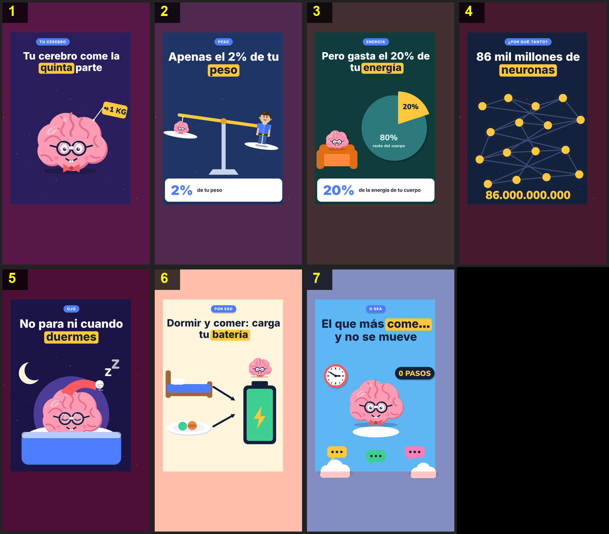

# Storyboard: cerebro-energia (flat2d)

| panel | scene | t (s) | type | title | stat |
|---|---|---|---|---|---|
| 1 | hook | 5.6 | question | Tu cerebro come la quinta parte |  |
| 2 | weight | 9.6 | stat | Apenas el 2% de tu peso | 2% |
| 3 | energy | 16.8 | stat | Pero gasta el 20% de tu energía | 20% |
| 4 | neurons | 25.5 | object | 86 mil millones de neuronas |  |
| 5 | sleep | 30.9 | object | No para ni cuando duermes |  |
| 6 | tip | 39.6 | process | Dormir y comer: carga tu batería |  |
| 7 | closing | 49 | closing | El que más come… y no se mueve |  |
