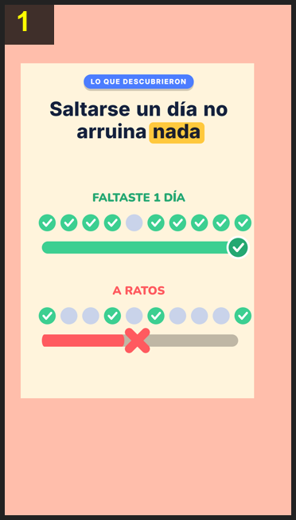

# Storyboard: habitos-66-dias (flat2d)

| panel | scene | t (s) | type | title | stat |
|---|---|---|---|---|---|
| 1 | hook | 30.8 | question | ¿Un hábito en 21 días? |  |
| 2 | study |  | object | Siguieron a 96 personas |  |
| 3 | avg |  | stat | En promedio: 66 días | 66 días |
| 4 | some |  | stat | ¿Y algunos? ¡254! | 254 |
| 5 | skip |  | comparison | Saltarse un día no arruina nada |  |
| 6 | tip |  | process | No estás fallando: vas a la mitad |  |
| 7 | const |  | comparison | Constancia, no perfección |  |
| 8 | closing |  | closing | No son 21 días: son 2 meses |  |
