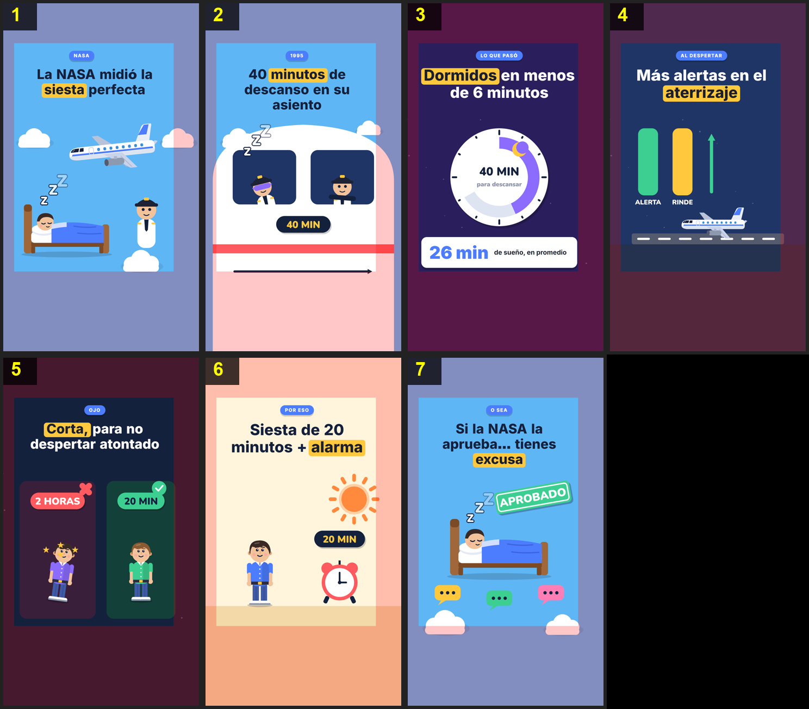

# Storyboard: siesta-nasa (flat2d)

| panel | scene | t (s) | type | title | stat |
|---|---|---|---|---|---|
| 1 | hook | 3.9 | question | La NASA midió la siesta perfecta |  |
| 2 | study | 14.5 | process | 40 minutos de descanso en su asiento |  |
| 3 | sleep | 20.6 | stat | Dormidos en menos de 6 minutos | 26 min |
| 4 | better | 28.5 | object | Más alertas en el aterrizaje |  |
| 5 | short | 35.9 | comparison | Corta, para no despertar atontado |  |
| 6 | tip | 43.4 | process | Siesta de 20 minutos + alarma |  |
| 7 | closing | 51.5 | closing | Si la NASA la aprueba… tienes excusa |  |
