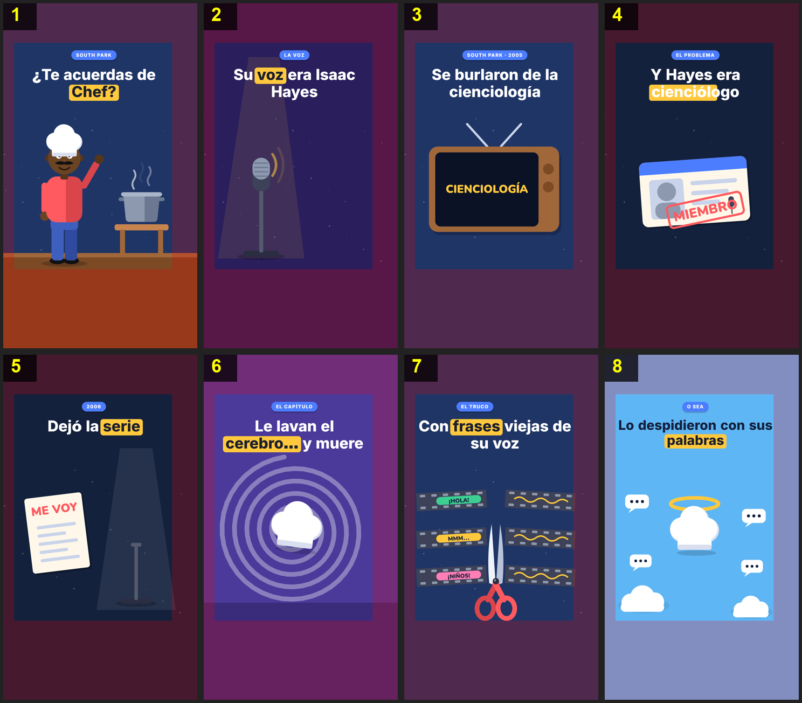

# Storyboard: chef-cienciologia (flat2d)

| panel | scene | t (s) | type | title | stat |
|---|---|---|---|---|---|
| 1 | hook | 2.88 | question | ¿Te acuerdas de Chef? |  |
| 2 | voice | 7.71 | object | Su voz era Isaac Hayes |  |
| 3 | episode | 12.28 | object | Se burlaron de la cienciología |  |
| 4 | member | 15.46 | object | Y Hayes era cienciólogo |  |
| 5 | quit | 19.87 | comparison | Dejó la serie |  |
| 6 | brainwash | 24.95 | process | Le lavan el cerebro… y muere |  |
| 7 | clips | 29.65 | process | Con frases viejas de su voz |  |
| 8 | closing | 35.67 | closing | Lo despidieron con sus palabras |  |
