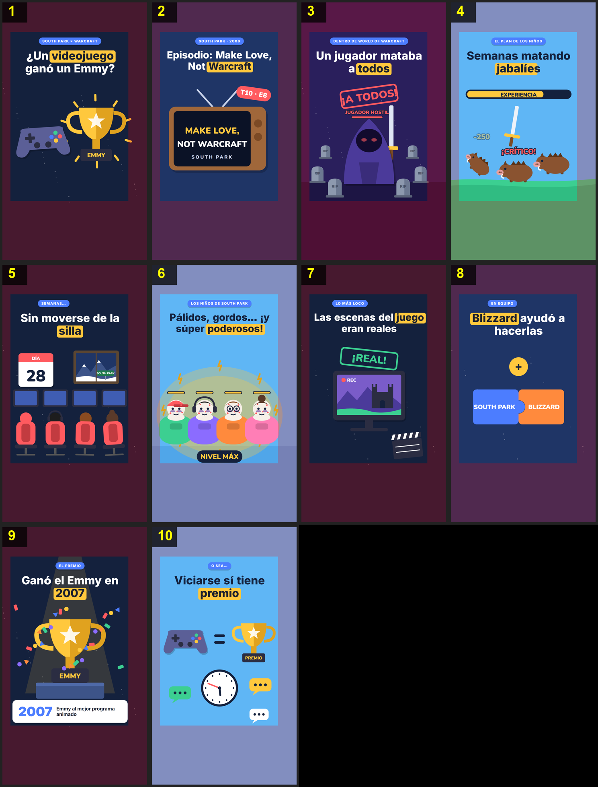

# Storyboard: emmy-warcraft (flat2d)

| panel | scene | t (s) | type | title | stat |
|---|---|---|---|---|---|
| 1 | hook | 2.8 | question | ¿Un videojuego ganó un Emmy? |  |
| 2 | episode | 7.4 | object | Episodio: Make Love, Not Warcraft |  |
| 3 | villain | 13.6 | object | Un jugador mataba a todos |  |
| 4 | grind | 18.65 | process | Semanas matando jabalíes |  |
| 5 | chair | 22.1 | object | Sin moverse de la silla |  |
| 6 | result | 26.5 | comparison | Pálidos, gordos… ¡y súper poderosos! |  |
| 7 | real | 29.9 | object | Las escenas del juego eran reales |  |
| 8 | blizzard | 33.6 | comparison | Blizzard ayudó a hacerlas |  |
| 9 | emmy | 37.5 | stat | Ganó el Emmy en 2007 | 2007 |
| 10 | closing | 43.5 | closing | Viciarse sí tiene premio |  |
