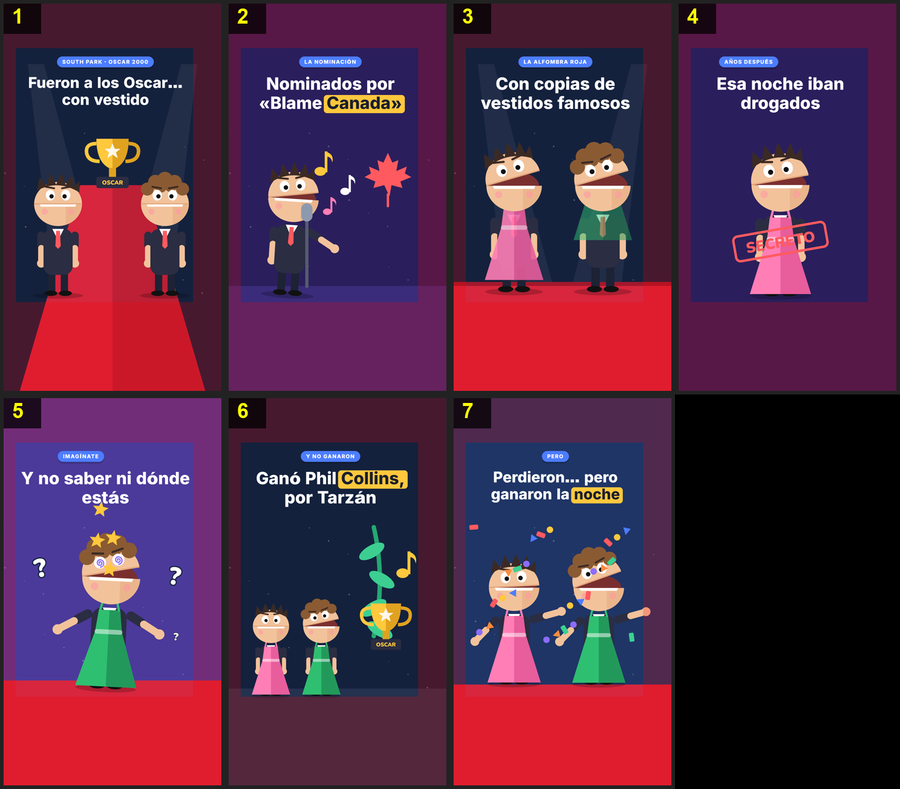

# Storyboard: oscar-vestidos (flat2d)

| panel | scene | t (s) | type | title | stat |
|---|---|---|---|---|---|
| 1 | hook | 2.67 | question | Fueron a los Oscar… con vestido |  |
| 2 | song | 8.4 | object | Nominados por «Blame Canada» |  |
| 3 | dresses | 15.23 | comparison | Con copias de vestidos famosos |  |
| 4 | secret | 21.13 | object | Esa noche iban drogados |  |
| 5 | dizzy | 25.63 | object | Y no saber ni dónde estás |  |
| 6 | winner | 30.17 | comparison | Ganó Phil Collins, por Tarzán |  |
| 7 | closing | 35.23 | closing | Perdieron… pero ganaron la noche |  |
