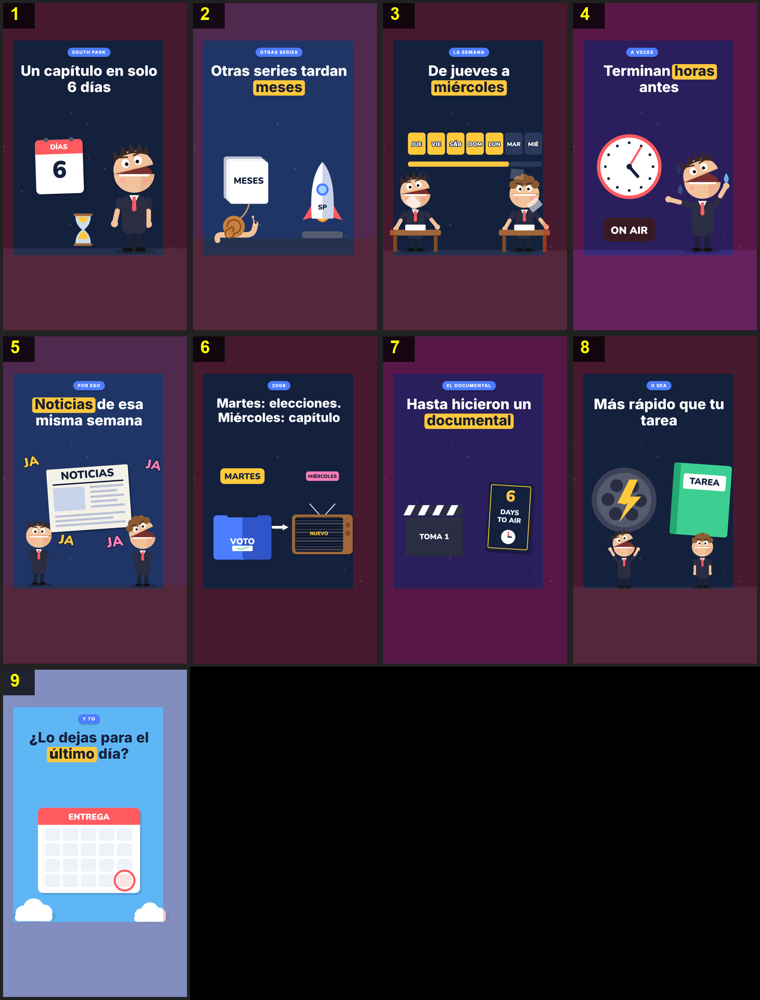

# Storyboard: seis-dias (flat2d)

| panel | scene | t (s) | type | title | stat |
|---|---|---|---|---|---|
| 1 | hook | 2.13 | question | Un capítulo en solo 6 días |  |
| 2 | others | 7.25 | comparison | Otras series tardan meses |  |
| 3 | week | 12.76 | process | De jueves a miércoles |  |
| 4 | rush | 17.07 | object | Terminan horas antes |  |
| 5 | news | 20.75 | object | Noticias de esa misma semana |  |
| 6 | election | 25.86 | comparison | Martes: elecciones. Miércoles: capítulo |  |
| 7 | doc | 31.12 | object | Hasta hicieron un documental |  |
| 8 | homework | 35.85 | comparison | Más rápido que tu tarea |  |
| 9 | closing | 40.04 | closing | ¿Lo dejas para el último día? |  |
