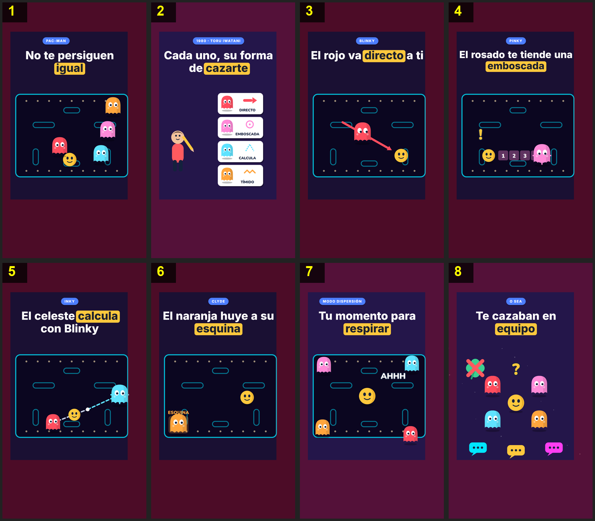

# Storyboard: pacman-fantasmas (flat2d)

| panel | scene | t (s) | type | title | stat |
|---|---|---|---|---|---|
| 1 | hook | 3.8 | question | No te persiguen igual |  |
| 2 | creator | 9.4 | object | Cada uno, su forma de cazarte |  |
| 3 | blinky | 12.6 | process | El rojo va directo a ti |  |
| 4 | pinky | 18.3 | process | El rosado te tiende una emboscada |  |
| 5 | inky | 22.9 | process | El celeste calcula con Blinky |  |
| 6 | clyde | 29.1 | process | El naranja huye a su esquina |  |
| 7 | scatter | 34.9 | object | Tu momento para respirar |  |
| 8 | closing | 43 | closing | Te cazaban en equipo |  |
