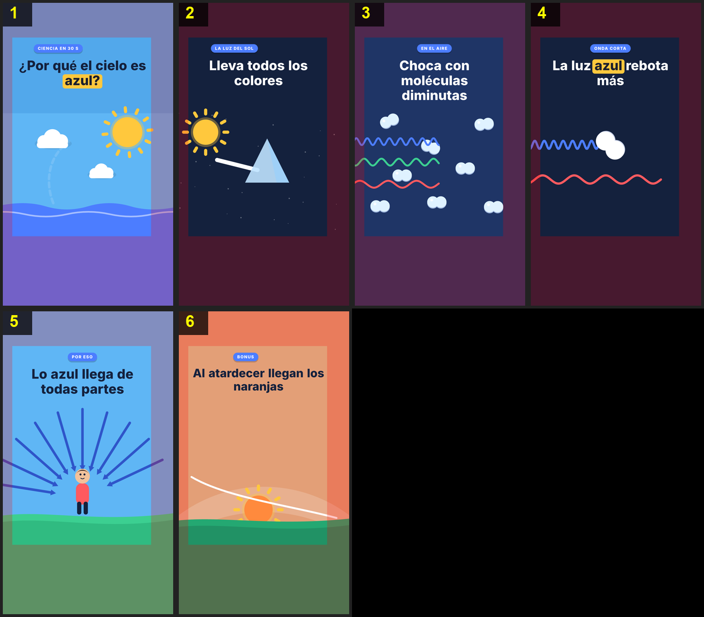

# Flat 2D: usage



Flat, saturated vector: clean shapes with no outlines, flat shadows in a darker shade of the same color, night-blue or sky backgrounds, and bold titles with the key word on a yellow pill. Everything is SVG animated on a single GSAP timeline at 30 fps.

**Good for** science, fun facts, quick explainers and anything with lots of text or diagrams. **Not for** textures or a "handmade" look.

## Steps for a video
1. **Audio.** Put your audio at `canales/<canal>/videos/<topic>/audio.wav` (or `.mp3`/`.m4a`). If you don't have one, write `script.json` and run `node core/voice.ts canales/<canal>/videos/<topic>`.
2. **Idea.** Tell the AI what you want to get across and, if you like, colors, tone or scenes. They end up in the `notes` field of `scenes.json`.
3. **Transcribe and analyze.**
   ```bash
   .venv/bin/python core/transcribe.py canales/<canal>/videos/<topic>
   ```
   ```bash
   node core/analyze.ts canales/<canal>/videos/<topic>
   ```
4. **Plan.** The AI writes `canales/<canal>/videos/<topic>/scenes.json` (with `"style": "flat2d"` and `"fps": 30`) and `canales/<canal>/videos/<topic>/visuals.ts`, shaped as `defineVisuals({ id: { bg, ink, html(s), anim(tl, s, K, $) } })`. Validate the plan and the types:
   ```bash
   node core/scenes.ts canales/<canal>/videos/<topic>
   ```
   ```bash
   npm run typecheck
   ```
5. **Storyboard.**
   ```bash
   node core/storyboard.ts canales/<canal>/videos/<topic>
   ```
   Check `storyboard.png` and ask for changes by panel number.
6. **Live-reload preview** (optional, with the audio):
   ```bash
   node core/preview.ts canales/<canal>/videos/<topic>
   ```
   Opens http://localhost:3002, or reuses it if it's already open (the page reloads by itself with this video). It stays open in the background and shows the last video built; close it with `node core/preview.ts canales/<canal>/videos/<topic> --stop`.
7. **Render.**
   ```bash
   node core/render.ts canales/<canal>/videos/<topic>
   ```
   Writes `final.mp4` and `report.md`.

## Safe zone (TikTok, Reels, Shorts)
The apps cover part of the video with their interface: the top tabs, the caption and music at the bottom (~440 px) and the like/comment/share buttons on the right (~140 px). Keep text, characters and key objects inside **x 60–940, y 220–1480** (`SAFE` in `library.ts`); only backgrounds (sky, ground, walls) fill the whole frame. The storyboard tints the covered zones red: nothing important should be there.

## Without voice (a quick test)
With no audio there's no `words.json`: `scenes.json` gives `"duration"` in seconds, every scene after the first its `"t0"` and every key its `"t"`, also in seconds. `scenes.ts`, `storyboard.ts` and `preview.ts` work the same; `render.ts` needs a voice. The setup prompt makes `ejemplos/hello/` this way.

## How a scene is written
```ts
defineVisuals({
  hook: {
    bg: F2.sky, ink: F2.night,                       // light background -> dark title
    html: () => svg(`${f2Sun('sun', 840, 820, 95)} ${f2Cloud('c1', 300, 880, 0.9)}`),
    anim(tl, s, K, $) {                               // ABSOLUTE video times
      tl.fromTo($('#sun'), { scale: 0, transformOrigin: '50% 50%' }, { scale: 1, duration: 0.6, ease: 'back.out(2)' }, s.t0 + 0.1);
      tl.fromTo($('#c1'), { x: -60 }, { x: 60, duration: s.t1 - s.t0, ease: 'none' }, s.t0);
    },
  },
});
```
- `K('key')` returns when that word is said.
- `$('#x')` selects only inside this scene.
- No `Math.random()` and no clocks: everything lives on the timeline.
- Put helper functions inside the scene (or in `library.ts` if they're reusable): every video's `visuals.ts` shares one global scope in the type check.

## What you can ask for in the notes
- **Colors:** the variables in `theme.css` (`--bg`, `--accent`, `--label`, `--stat`) and the `F2` palette in `library.ts`.
- **Typography:** `--font` in `theme.css`.
- **What doesn't change:** the flat look (no textures, no realistic gradients, no outlines).

## Library pieces (`library.ts`)
`svg(body)` · `f2Pop(tl, selector, t)` · `f2Sun` · `f2Cloud` · `f2Hill` · `f2Molecule` · `f2Wave(id, x0, x1, y, L, A, color)` · `f2Arrow` · `f2Person` · `f2Me` (a more detailed person, same face) · the `F2` and `RAINBOW` palettes, plus one generic scene per type. The types (`Visual`, `Scene`) are in `globals.d.ts`.
